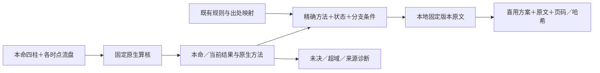

# GX_algorithm

八字资料的结构化索引、规则与出处映射、原生取用结果的证据适配代码。

本仓库对应已部署的 `20261110-v2`。计算继续调用固定的 `core-yongshen v0.4.0` 算核；这里维护索引和证据层，保留原方法、条件、完整辅助组合及未决状态，不重新实现命理算法。

**资料留在原存储环境。** 仓库不包含原书、扫描件、约 28 GB 研究档案、全文引文、SQLite 数据库、运行包或真实运行日志。规则仍保留来源版本、篇章页码、对象哈希和原规则 ID，可与本地资料准确对应。

## 代码和规则

| 位置 | 内容 |
|---|---|
| [src/catalog_builder.py](src/catalog_builder.py) | 导入已有 manifest 与登记表，构建 SQLite 资产／路径／规则／证据索引 |
| [scripts/expand_catalog.py](scripts/expand_catalog.py) | 复用已有索引，只增量替换核准的证据表；禁止覆盖旧数据库 |
| [src/catalog_queries.py](src/catalog_queries.py) | 中文 FTS 检索、路径与规则查询；检索命中不直接变成依据 |
| [src/engine_adapter.py](src/engine_adapter.py) | 验证固定算核身份并调用原生程序，保留完整结果 |
| [src/pipeline.py](src/pipeline.py) | 按精确方法、状态和原生分支条件连接引用；区分正文、评注、工程依据及诊断 |
| [src/server_cli.py](src/server_cli.py) | 已部署的管理员封装：隔离 Docker、版本配对、请求与响应审计 |
| [rules/RULES.md](rules/RULES.md) | 人可读的规则、条件、对应来源清单 |
| [rules/rule_catalog.json](rules/rule_catalog.json) | 38 个既有规则／来源字段、35 个方法绑定、45 条关联、43 个片段定位、13 个来源 |
| [rules/method_inventory.json](rules/method_inventory.json) | 28 个新增模块的采用凭证与范围；另保留 H1 规则 |
| [rules/runtime-dependency.json](rules/runtime-dependency.json) | 原生运行包、源码版本、安装清单与隔离镜像的固定身份 |
| [rules/constructed_cases.json](rules/constructed_cases.json) | 69 份人工构造的集成输入与预期条件；无完整响应或私人资料 |

源码与部署版本的对应哈希见 [code-provenance.json](verification/code-provenance.json)。原算核是外部依赖，需要使用原有授权取得，不从这个仓库自动下载或替代它。

## 数据流与规则



1. 原生程序决定方法、喜用和主次；证据层不重新计算或猜测缺失条件。
2. `native_method_exact` 必须精确匹配，状态须在 `allowed_result_states` 中。
3. 有额外限制时，继续匹配 `required_result_predicates`，例如原生返回的财食题型或调候任务 A/B/C。
4. 仅通过显式 `rule_id → passage_id → source_id` 关联附引文，不因搜索相似就引用。
5. `auxiliary.alternatives` 的组内共同需要、组间可替代和主次保持原样。来源诊断、其他候选方法不能覆盖公共结论。

仓库中的片段只保存定位和 `quote_sha256`，没有原文内容。`original_rule_conditions` 是已有规则卡中的条件／排除／算法声明，其余原记录以哈希定位；不是新增一套取用算法。

## 不带资料也能验证

索引和测试使用 Python 3.11+ 标准库，本轮使用 Python 3.13 验证。

```bash
git clone https://github.com/doyoulikelin-wq/GX_algorithm.git
cd GX_algorithm
python3 -B -m unittest discover -s tests -v
python3 -B scripts/validate_rules.py
python3 -B scripts/check_publication.py
```

单元测试使用合成文本、临时 SQLite 和模拟原生返回，覆盖索引构建、中文检索、不同方法隔离、条件门、未决保留、完整组合、来源层次、篡改拒绝等。它们不需要资料或私有运行包，也不冒充真实算法运行。

## 连接本地资料

完整步骤见 [运行说明](docs/RUNNING.md)。已部署环境可继续使用原入口：

```bash
bazi-evidence analyze examples/B13_wu_relations_jiaji_candidate.json
```

需要重建索引时，先用授权持有的私有证据种子恢复引文。工具会核对种子的完整 SHA 和公开规则投影，不能把任意同名文本拼进去：

```bash
# GX_PRIVATE_SEED 指向授权持有的 v2 私有 evidence_seed.json。
python3 -B scripts/materialize_seed.py \
  --private-seed "$GX_PRIVATE_SEED" \
  --output .local/evidence_seed.json
```

`.local/`、资料格式、数据库、运行日志与压缩包均被 Git 忽略；发布检查还会扫描实际暂存内容，防止强制添加后混入资料。

## 已有验证与边界

[服务器验证摘要](verification/prior-server-summary.json)记录上轮真实运行：69 份输入与旧版完整原生结果一致，61 项回归检查及 6 项加强输入门检查通过。测试样例中，20 个新增模块有当前确定结果与出处，4 个验证到本命结论，4 个只提供来源诊断。原 H1 链单独回归通过。

财从的任氏依从分支已有来源映射，但尚缺命中该分支条件的正例；普通财食分支已测通。这里不把“方法已登记”“软件检查通过”或“来源有记载”当作所有输入都能得出确定喜用。

当前输入仍是已经提供的四柱与流盘，时间标签不证明历法真伪；地点不参与本层传统喜用计算。当前链没有接入 LLM。原文证明的是传统方法依据，数值比例和裁决来自原项目工程模型；这些软件测试不构成现实预测验证。
